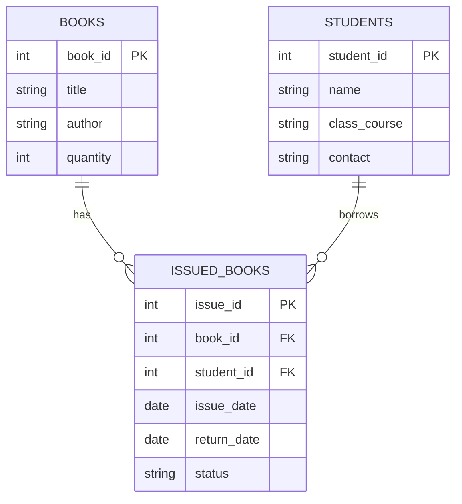

# 📚 Library Management System

A simple Library Management System developed using **Python and MySQL** to manage books, students, and book issue and return records.

## 🚀 Project Overview

The Library Management System is a menu-driven Python application connected to a MySQL database.

It helps manage basic library operations such as adding books, registering students, issuing books, returning books, and maintaining library records.

## ✨ Features

- Add new books
- View all books
- Search books by title
- Register students
- View student records
- Issue books to students
- Return issued books
- View issued-book records
- Update book quantities during issue and return operations

## 🛠️ Technologies Used

- Python
- MySQL
- mysql-connector-python
- Visual Studio Code
- MySQL Workbench


---

## 🗄️ Database Design

The project uses a MySQL database named `library`.

It contains three main tables:

### 1. Books Table

Stores information about books available in the library.

| Column | Description |
|---|---|
| book_id | Unique ID of each book (Primary Key) |
| title | Name of the book |
| author | Name of the author |
| quantity | Available book quantity |

### 2. Students Table

Stores information about students registered in the library.

| Column | Description |
|---|---|
| student_id | Unique student ID (Primary Key) |
| name | Student name |
| class/course | Student's class or course |
| contact | Student contact details |

### 3. Issued Books Table

Stores information about books issued to students.

| Column | Description |
|---|---|
| issue_id | Unique issue ID (Primary Key) |
| book_id | Reference to the books table (Foreign Key) |
| student_id | Reference to the students table (Foreign Key) |
| issue_date | Date of book issue |
| return_date/status | Book return information |

### Entity Relationship Diagram (ER Diagram)



### Relationships Between Tables

1. **Books → Issued Books (One-to-Many):** One book can have multiple issue records over time. Each issue record refers to one book.

2. **Students → Issued Books (One-to-Many):** One student can have multiple issue records. Each issue record refers to one student.

The `issued_books` table connects the `books` and `students` tables.


---

## ⚙️ Installation and Setup

Follow these steps to run the Library Management System on your computer.

### 1. Install Python

Download and install Python from:

https://www.python.org/downloads/

### 2. Install MySQL

Install MySQL Server and MySQL Workbench.

### 3. Clone the Repository

Open your terminal and run:

```bash
git clone YOUR_GITHUB_REPOSITORY_URL
```

### 4. Open the Project Folder

```bash
cd Library-Management-System
```

### 5. Install Required Package

```bash
pip install mysql-connector-python
```

### 6. Configure the Database

- Open MySQL Workbench.
- Create a database named `library`.
- Make sure the required tables are created.
- Update the MySQL username and password in `database.py` according to your system.

### 7. Run the Application

Open the VS Code terminal and execute:

```bash
python main.py
```

The Library Management System menu will appear in the terminal.


---

## 🎯 Project Objectives

- To simplify library management activities.
- To maintain book and student records.
- To manage book issue and return operations.
- To understand Python and MySQL connectivity.
- To gain practical experience in database management.

## 🔮 Future Improvements

- Graphical User Interface (GUI)
- Admin login and authentication
- Book issue and return reports
- Barcode scanning
- Automatic due-date reminders

## 👩‍💻 Author

**Disha Pramanik**

B.Tech – Computer Science and Engineering

Techno India University

## 📄 License

This project is developed for educational and learning purposes.
